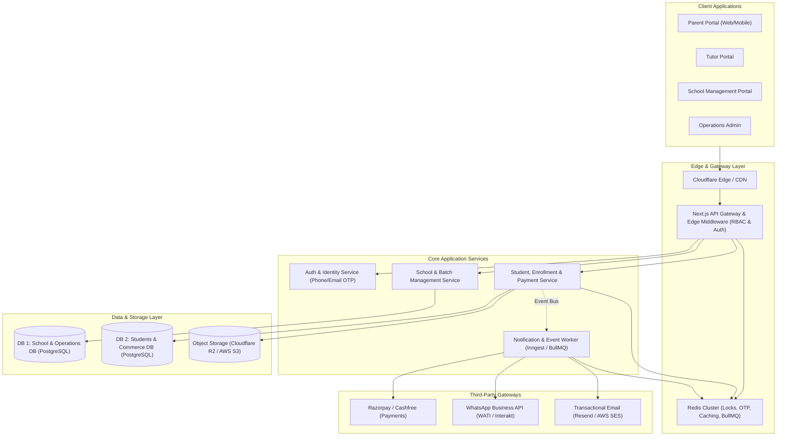
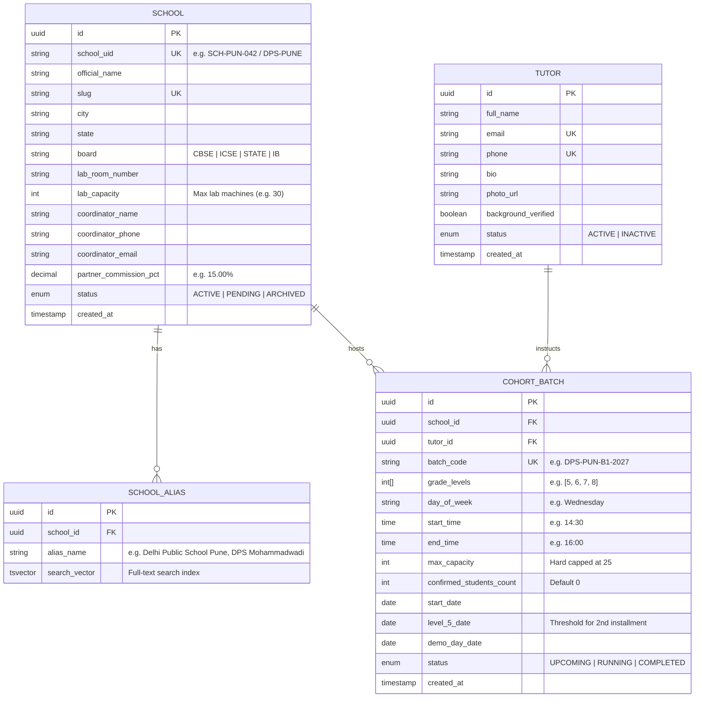
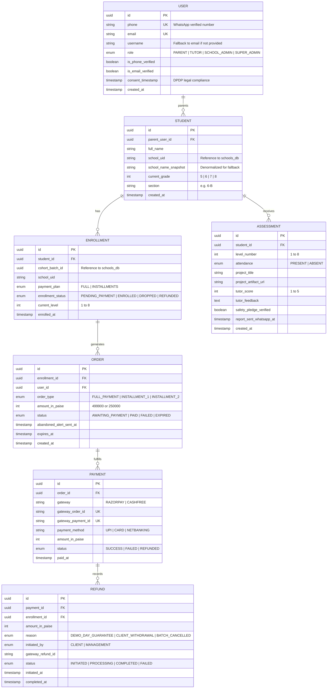
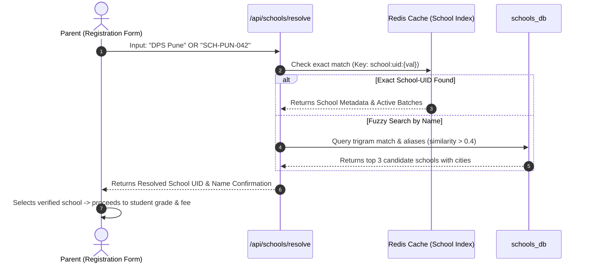
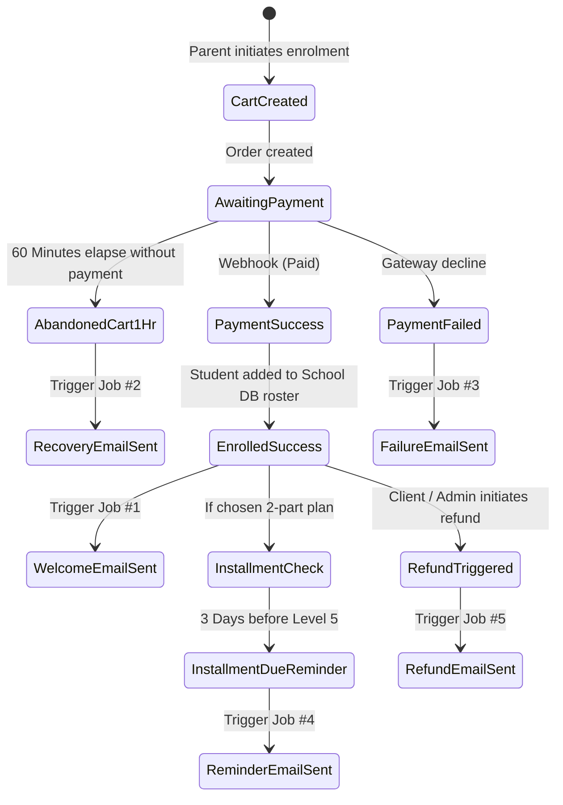
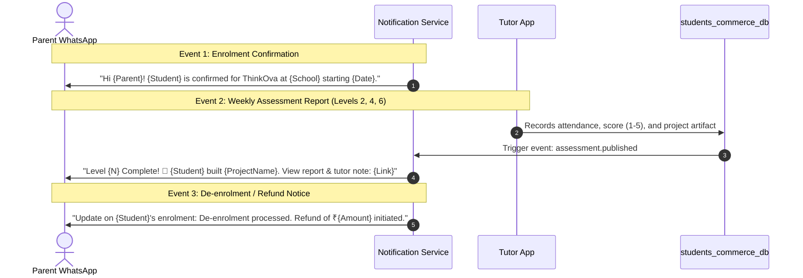
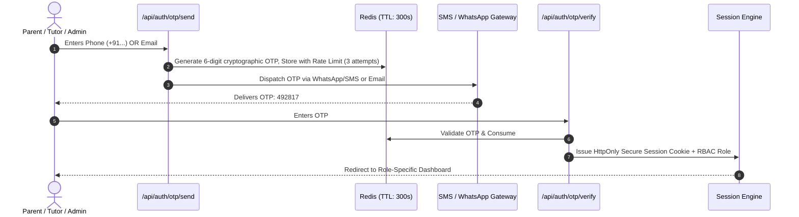
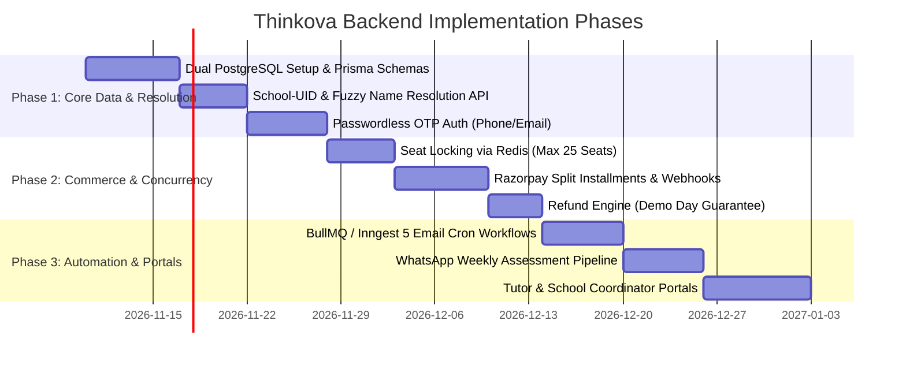

# ThinkOva — Complete Backend Architecture Plan

## Executive Summary
Thinkova is an in-school cohort-based AI education program for school students (Grades 5–8) delivered through partner school computer labs. This document defines a production-ready, highly concurrent backend architecture covering:
- **Dual-Database Strategy** (School Management DB & Student/Commerce DB)
- **School-UID & Name Auto-Resolution Engine**
- **High Concurrency & Seat Race-Condition Prevention**
- **Automated Email Cron Jobs & Transactional Lifecycle**
- **WhatsApp Messaging & Weekly Assessment Pipelines**
- **Passwordless OTP Authentication & RBAC Route Management**

---

## 1. System Architecture Overview



---

## 2. Dual-Database Strategy & Schemas

### Architectural Rationale
Separating the **School Management** domain from the **Student & Commerce** domain provides:
1. **Security & Compliance:** Student PII (COPPA / DPDP regulations) is isolated from B2B partner agreements and financial commission ledgers.
2. **Scalability:** The Student/Commerce database handles 98% of peak write operations (enrolment bursts, checkout concurrency, cart expirations), without locking administrative school tables.
3. **Decoupled Life Cycle:** B2B school onboarding operates on an institutional timeline, while B2C student transactions are event-driven.

---

### Database 1: `schools_db` (School & Institutional Management)

This database manages partner schools, campus facilities, computer lab constraints, tutor assignments, and cohort batch schedules.



---

### Database 2: `students_commerce_db` (Parents, Students & Financials)

This database handles parent user accounts, student/ward profiles, orders, installment payment schedules, refunds, and weekly assessments.



---

## 3. School Identification & Parent Resolution Engine

To prevent parents from failing registration if they do not remember the `School-UID` from their school circular:



### API Implementation: `GET /api/schools/resolve`
1. **Primary Match (Exact UID):** Case-insensitive check on `school_uid` (e.g., `DPS-PUNE`).
2. **Fallback Match (Fuzzy Name):** Uses PostgreSQL `pg_trgm` similarity index over `official_name` and `school_aliases`.
3. **Payload returned:**
```json
{
  "schoolUid": "SCH-PUN-042",
  "name": "Delhi Public School, Mohammadwadi",
  "city": "Pune",
  "eligibleGrades": [5, 6, 7, 8],
  "upcomingBatches": [
    { "batchId": "uuid-1", "day": "Wednesday", "time": "14:30", "seatsRemaining": 7 }
  ]
}
```

---

## 4. API Concurrency & Scalability Architecture

### Peak Spike Problem
When a school sends out a WhatsApp circular to 1,500 parents simultaneously, hundreds of parents reach the checkout page at once. Each batch is strictly capped at **25 students**.

```mermaid
flowchart LR
    Request["Parent Initiates Enrolment"] --> RedisLock{"Acquire Seat Lock in Redis<br/>SET cohort:{id}:seat:{uid} EX 900 NX"}
    RedisLock -->|Lock Acquired| RazorpayOrder["Create Razorpay Order<br/>(15-Minute Seat Hold)"]
    RedisLock -->|Batch Full (Count >= 25)| Waitlist["Prompt Parent:<br/>Join Waitlist / Next Cohort"]
    RazorpayOrder --> PaymentWait{"Payment Completed within 15 Min?"}
    PaymentWait -->|Yes: Webhook Received| Confirm["Finalize DB Seat<br/>Mark ENROLLED"]
    PaymentWait -->|No: Lock Expires| ReleaseLock["Redis TTL Evicts Lock<br/>Seat Becomes Available"]
```

### Concurrency Guarantees:
1. **Atomic Distributed Locks:** Redis `SET resource_key my_random_value NX PX 900000` reserves a seat for 15 minutes while the parent completes the UPI/Card transaction.
2. **Database Idempotency:** Webhook processing checks `gateway_payment_id` with `INSERT ... ON CONFLICT (gateway_payment_id) DO NOTHING` to prevent double-charging or duplicate bookings.
3. **Connection Pooling:** Use PgBouncer or AWS RDS Proxy in front of PostgreSQL to prevent serverless Lambda/Edge function connection exhaustion during traffic surges.

---

## 5. Automated Email Cron Jobs & Lifecycle

All cron and delayed jobs are managed via an event-driven scheduler (such as **Inngest** or **BullMQ + Redis**):



### Detailed Job Specifications:

| Job Name | Trigger / Schedule | Target Recipient | Payload & Action |
|---|---|---|---|
| **1. Enrolment Success** | Instant event on `order.paid` + Roster entry | Parent Email | Welcome pack, student ID, school lab schedule, tutor introduction, orientation date. |
| **2. Cart Abandoned (> 1 Hour)** | Delayed check scheduled at `order.created + 60m` | Parent Email | *"Your child's seat in [School Name] is held for a limited time. Click here to resume payment."* |
| **3. Payment / Enrolment Failure** | Instant event on `payment.failed` webhook | Parent Email | Transaction failure code, explanation (e.g. bank timeout), and 1-click retry payment link. |
| **4. Installment 2 Due (3 Days Prior)** | Daily Cron running at 09:00 AM IST | Installment plan parents | Filters students at Level 4 where Level 5 starts in 3 days. Includes direct ₹2,499 UPI payment link. |
| **5. Refund Notification** | Instant event on `refund.initiated` | Parent Email | Refund reference number, amount (e.g. ₹2,499 demo-day guarantee or full), and bank credit ETA (5–7 days). |

---

## 6. WhatsApp Messaging Engine & Weekly Assessments

Indian parents interact with WhatsApp significantly more reliably than email. The WhatsApp service integrates with **WATI / Interakt / Gupshup** using official Meta templates:



### Outbound WhatsApp Routes:
1. `POST /api/webhooks/whatsapp/inbound`: Receives incoming parent replies (`STOP`, queries) and updates consent preferences.
2. `POST /api/notifications/whatsapp/enrollment-confirmed`: Sends instant receipt + circular confirmation.
3. `POST /api/notifications/whatsapp/weekly-report`: Dispatches weekly milestone cards after Levels 2, 4, 6, and Demo Day.
4. `POST /api/notifications/whatsapp/installment-alert`: Direct WhatsApp payment prompt for Installment 2.

---

## 7. Authentication, OTP & Route Management System

### Passwordless OTP Authentication Flow



### Username Fallback Logic
```typescript
function resolveUsername(input: { username?: string; email: string }): string {
  if (input.username && input.username.trim().length >= 3) {
    return input.username.trim().toLowerCase();
  }
  // Fallback: Default username to email address
  return input.email.trim().toLowerCase();
}
```

### RBAC Route Protection (Next.js Middleware)

```
/
├── (public)
│   ├── /                         -> Landing Page
│   ├── /auth/login               -> OTP Login (Phone / Email)
│   ├── /enrol                    -> School UID / Name Enrolment Flow
│   └── /legal/[slug]             -> Policies & Curriculum PDF
│
├── /parent (Role: PARENT)
│   ├── /parent/dashboard         -> Enrolled children overview
│   ├── /parent/progress/[id]     -> Weekly level tracker & project artifacts
│   └── /parent/payments          -> Installment 2 pay button & invoices
│
├── /tutor (Role: TUTOR)
│   ├── /tutor/batches            -> Assigned school computer lab batches
│   ├── /tutor/attendance         -> Weekly 90-min session attendance marking
│   └── /tutor/assessments        -> Grade Level 1-8 project submissions
│
├── /school (Role: SCHOOL_ADMIN)
│   ├── /school/roster            -> List of enrolled students by grade
│   ├── /school/lab-schedule      -> Computer lab timing & assigned tutor
│   └── /school/partner-fees      -> Accumulated school revenue-share report
│
└── /admin (Role: SUPER_ADMIN)
    ├── /admin/schools            -> School onboarding & UID generator
    ├── /admin/tutors             -> Tutor vetting & batch assignment
    ├── /admin/finance            -> Razorpay reconciliations & refund processing
    └── /admin/cron-logs          -> Queue health & WhatsApp delivery audits
```

---

## 8. Potential Bottlenecks & Mitigations

| Area | Potential Bottleneck | Mitigation Strategy |
|---|---|---|
| **School UID Entry** | Parent typos or missing circular information. | Fuzzy search fallback (`pg_trgm`) resolving school name + city seamlessly. |
| **Seat Overbooking** | Simultaneous checkout for the final 25th seat in a batch. | Redis distributed lock (`SET NX EX 900`) reserving the seat during checkout. |
| **Webhook Timeouts** | Razorpay webhooks failing under concurrent traffic. | Acknowledge webhook immediately (`200 OK`) and push event into BullMQ background queue. |
| **WhatsApp Rate Limits** | Meta API enforces rate limits on bulk template dispatch. | Queue throttling with jitter (maximum 30 messages/second per number). |
| **Database Contention** | Heavy reporting and assessment queries impacting payments. | Separate read-replicas for school coordinators and administrative queries. |

---

## 9. Implementation Roadmap



